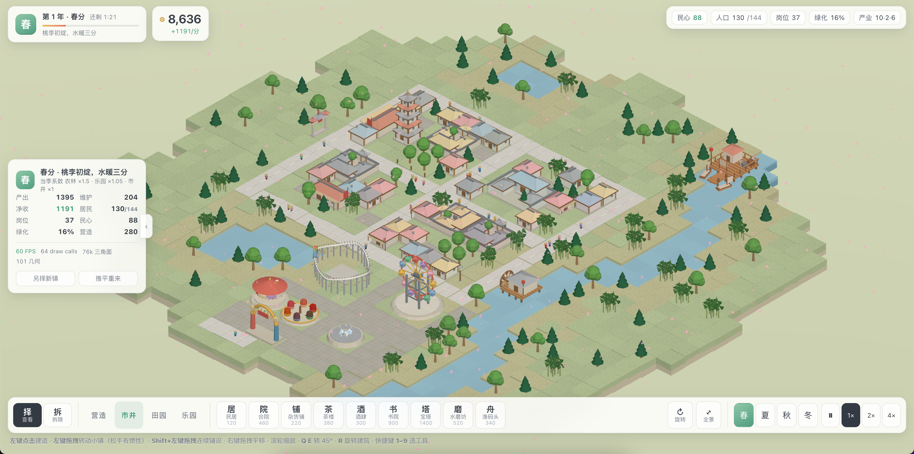
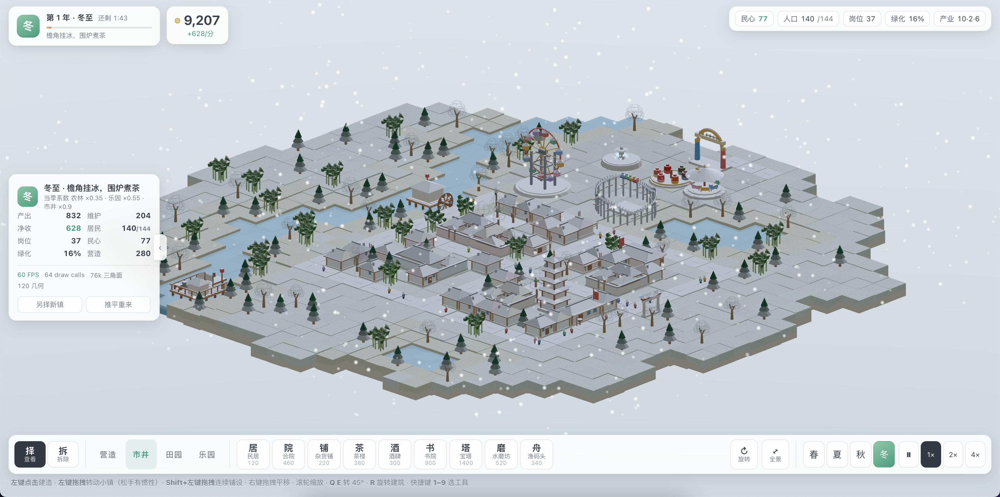

# 四季小镇 · 云溪

一座会过四季的中式等距小镇 + 乐园建造小游戏。**纯代码生成，0 张外部素材**——所有建模、纹理、天空、特效均由代码实时绘制。

- 27 种建筑、278 个物件，统一压进约 60 个 draw call，全程 60 FPS。
- 换季不重建任何几何体，只改十几个全局标量（雪、叶色、风向……）。
- 开局即"云溪镇"，无需注册、无需加载、无 `assets/` 目录。

## 技术栈

| 层 | 选型 |
| --- | --- |
| 框架 | Vue 3 + TypeScript + Vite 8 |
| 渲染 | Three.js 0.186（`WebGLRenderer`，正交相机） |
| 状态 | 单个 `reactive` 的 `state` + 渲染层 `Scene` |
| 美术 | 无（全部代码生成） |

## 快速开始

```bash
npm install
npm run dev        # 启动开发服务器，默认 http://localhost:5274
npm run typecheck  # vue-tsc --noEmit 类型检查，要求零错误
npm run build      # 构建到 dist/，产物约 712 kB（gzip 196 kB）
npm run preview    # 本地预览构建产物，默认 http://localhost:4274
```

> 局域网访问：已将 `vite.config.ts` 的 `server.host` 设为 `true`，终端启动时会打印 `Network:` 地址，同一网络下的设备可直接通过该 IP 访问。

## 截图预览





## 玩法

点击界面右上角的季节按钮切换四季，小镇会实时变化：

| 季节 | 表现 |
| --- | --- |
| 春分 | 天光转青，桃花瓣斜落，树冠转嫩绿 |
| 夏至 | 阳光垂直，影子变短，空气中飘花粉 |
| 秋分 | 全岛树木染橙黄，落叶盘旋，水田泛金 |
| 冬至 | 草色褪灰白，屋顶覆雪，雪片静落 |

相机操作：

| 操作 | 行为 |
| --- | --- |
| 左键点击 | 建造 / 选择 / 拆除 |
| 左键拖拽 | 转动小镇（松手带惯性） |
| Shift + 左键拖拽 | 连续铺设 |
| 右键 / 中键拖拽 | 平移 |
| 滚轮 | 缩放 |
| Q / E | 精确转 45° |
| R | 旋转待放置建筑 |

## 目录结构

```
3d-mini-game-demo/
├─ src/
│  ├─ components/   # Vue 组件（UI 层）
│  ├─ game/         # 游戏逻辑（布镇、状态、建造）
│  ├─ three/        # Three.js 渲染层（场景、合批、季节）
│  ├─ App.vue
│  ├─ main.ts
│  └─ styles.css
├─ vite.config.ts
├─ tsconfig.json
└─ package.json
```

## 想换一张地图？

布镇由固定种子生成，改一行种子即可重开一座不同的小镇。

## 设计约束

本项目坚持"零外部素材"原则：不引入任何 GLB / GLTF / FBX / OBJ / HDR / 图片纹理，所有视觉均由代码生成。这一约束直接催生了程序化天空、程序化纹理、全局季节标量、按材质合批等一系列架构设计。

详见 [`提示词文档.md`](./提示词文档.md) 了解项目给 AI 协作者的硬约束、红线与验证闭环。
